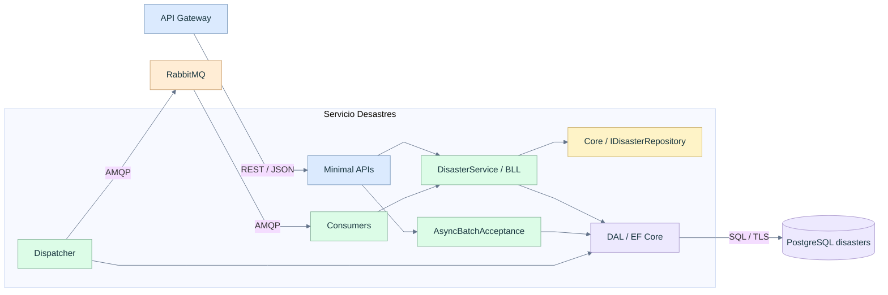
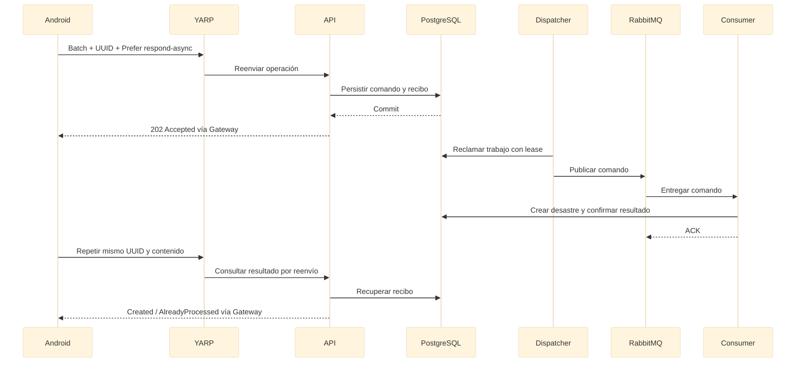
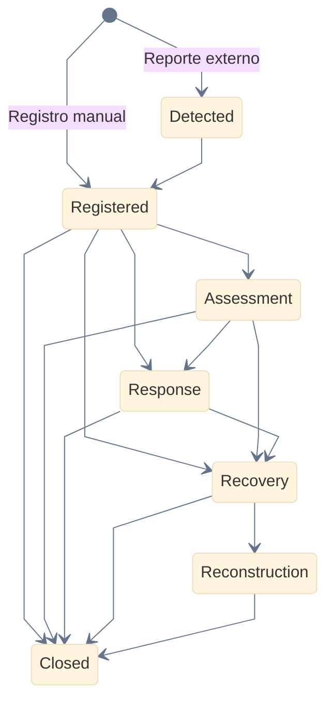

<div align="center">

# RECONECTA

### Disaster Management

**De la emergencia a la reconstrucción**

Servicio propietario del ciclo de vida de los eventos de desastre.


**Pontificia Universidad Javeriana**

Arquitectura de Software · 2026

[Plataforma completa](https://github.com/disaster-management-platform/disaster-platform-infrastructure) · [Arquitectura](#arquitectura) · [Demostración](#demostración) · [Instalación](#instalación-y-ejecución)

</div>

---

## Demostración

<div align="center">

[](https://youtu.be/HVCKoTRAxu8)

[Ver demostración funcional de RECONECTA](https://youtu.be/HVCKoTRAxu8)

</div>

## Descripción

`disaster-backend-offline` implementa el módulo de Gestión de Desastres de RECONECTA. Es el propietario canónico de los eventos, sus fases, geografía, reportes asociados y referencias organizacionales. Implementa arquitectura en capas con ASP.NET Core Minimal APIs, BLL y DAL distribuido como paquetes NuGet. Atiende clientes web y móviles mediante REST, y admite recepción asíncrona durable para sincronización masiva.

## Contenido

- [Funcionalidades](#funcionalidades)
- [Arquitectura](#arquitectura)
- [Decisiones arquitectónicas](#decisiones-arquitectónicas)
- [Tecnologías y justificación](#tecnologías-y-justificación)
- [Estructura del repositorio](#estructura-del-repositorio)
- [Integración con otros componentes](#integración-con-otros-componentes)
- [Persistencia](#persistencia)
- [Contratos de comunicación](#contratos-de-comunicación)
- [Seguridad](#seguridad)
- [Instalación y ejecución](#instalación-y-ejecución)
- [Pruebas](#pruebas)
- [Alcance y validación](#alcance-y-validación)
- [Repositorios relacionados](#repositorios-relacionados)
- [Autores](#autores)

## Funcionalidades

| Funcionalidad | Descripción |
| --- | --- |
| Registro | Creación manual o preliminar por reporte externo normalizado. |
| Ciclo de vida | Transiciones autorizadas, control de versiones y auditoría. |
| Geografía | Coordenadas, radio opcional, polígonos GeoJSON y referencias territoriales. |
| Consolidación | Sugerencias por tipo, municipio y ventana de ±72 h; asociación explícita de reportes. |
| Offline First | Batch, Delta y recibos durables; el almacenamiento offline reside en Android. |
| Alertas | Persistencia y publicación de eventos de detección, fase, atención y área; no equivale a entrega de notificaciones. |

## Arquitectura

### Vista lógica

La API depende de BLL y compone las implementaciones del DAL, mientras la BLL consume contratos de Core. Los workers forman parte del servicio, no del Gateway.




### Responsabilidades de los componentes

| Componente | Responsabilidad |
| --- | --- |
| DisasterLocation | Endpoints, composición DI, autenticación y workers. |
| DisasterLocation.BLL | Validaciones, creación, actualizaciones y reglas de transición. |
| DisasterLocation.Core | DTOs del contrato HTTP; modelos compartidos en DisasterPlatform.Core. |
| DisasterPlatform.DAL | Repositorio, recibos, esquema, auditoría y Outbox. |
| DisasterDispatcher / DisasterConsumers | Publicación confirmada y consumo de comandos con recuperación acotada. |

### Vista de procesos y sincronización asíncrona

El proceso ASP.NET Core aloja Kestrel y los servicios de fondo habilitados. Pueden desplegarse instancias con perfiles de API, dispatcher o consumers; RabbitMQ y PostgreSQL son procesos independientes.


### Ciclo de vida


Las transiciones usan `expectedVersion`; los saltos y el cierre requieren justificación, y el cierre exige confirmación de ausencia de compromisos críticos. No existe verificación automática completa entre dominios.

## Decisiones arquitectónicas

| Atributo de calidad | Decisión | Mecanismo y compromiso |
| --- | --- | --- |
| Disponibilidad | Procesamiento desacoplado | Recepción durable y workers independientes; requiere persistencia disponible. |
| Resiliencia | Idempotencia | UUID, recibos inmutables, reintentos y DLQ; puede requerir intervención. |
| Escalabilidad | Batch y Delta | Lotes de 50, páginas de 50 y concurrencia 2 por defecto; protege tráfico interactivo. |
| Integridad | Control optimista | Versión, índice único y transacciones locales; los conflictos son visibles. |
| Interoperabilidad | REST y AMQP | Contratos canónicos sin compartir tablas con otros servicios. |
| Modificabilidad | Capas y repositorios | Core abstrae persistencia; paquetes deben mantenerse compatibles. |

## Tecnologías y justificación

| Tecnología | Justificación para la integración |
| --- | --- |
| .NET 10 / ASP.NET Core | Minimal APIs y DI integran clientes Kotlin, Razor y Java mediante HTTP sin acoplar runtimes. |
| EF Core / Npgsql | El DAL comparte mecanismos PostgreSQL con Reconstrucción sin conceder acceso cruzado a esquemas. |
| RabbitMQ / AMQP | Desacopla recepción del procesamiento y permite repartir consumidores; admite entrega repetida. |
| PostgreSQL / Supabase | Índices, transacciones y secuencias preservan recibos y cursores entre réplicas. |
| NuGet | Distribuye Core, DAL y Security con versiones explícitas; evita duplicar código. |
| Docker | Empaqueta el servicio y permite configurar perfiles de ejecución desde Infrastructure. |

## Estructura del repositorio

```text
disaster-backend-offline/
├── DisasterLocation/             # API, Messaging, Security
├── DisasterLocation.BLL/         # DisasterService, Integration, GeographyValidation
├── DisasterLocation.Core/        # Contracts.cs
├── DisasterLocation.Tests/
├── scripts/                      # smoke_test.py, async_ingestion_test.py
├── DisasterLocation.sln
├── Dockerfile
└── README.md
```

## Integración con otros componentes

El portal y Android consumen el Gateway. Integration Service envía reportes externos normalizados a `/api/reportes-desastre`. Evaluación de Daños y Reconstrucción consultan al propietario por REST para verificar contexto. La publicación AMQP utiliza `disasters.commands`, `disasters.events`, `disasters.create`, `disasters.create.dlq` y `disasters.events.pending`. No se leen tablas de Eden ni de Reconstrucción.

Los despachadores reclaman trabajo con `SKIP LOCKED` y leases de 30 s; no mantienen una transacción abierta mientras publican. Confirmaciones perdidas pueden repetir una entrega, resuelta por la identidad persistida.

## Persistencia

El esquema `disasters` pertenece exclusivamente a este servicio. Las versiones actuales referenciadas son Core 5.0.0, DAL 7.0.0 y Security 1.0.0. EF Core conserva `ClientRequestId`, snapshot original, `CreatedBy` dentro del snapshot, versión, auditoría, recibos y Outbox. Delta filtra por ámbito antes de paginar, y utiliza `SyncSequence` con asignación bajo advisory lock transaccional. El cursor no se adelanta a escrituras pendientes. Los datos históricos desconocidos no se inventan. La creación original y el GET vigente pueden devolver versiones distintas deliberadamente.

## Contratos de comunicación

| Método | Ruta | Responsabilidad |
| --- | --- | --- |
| GET / POST | `/api/desastres` | Listado / registro idempotente. |
| GET / PUT | `/api/desastres/{id}` | Detalle / modificación versionada. |
| PUT | `/api/desastres/{id}/fase` | Transición de fase. |
| GET | `/api/desastres/{id}/historial` | Auditoría. |
| GET / POST | `/api/tipos-desastre` | Catálogo / alta. |
| PUT | `/api/tipos-desastre/{id}/desactivar` | Desactivación. |
| POST | `/api/desastres/batch` | Lotes con resultados por UUID. |
| GET | `/api/desastres/sync` | Delta por cursor. |
| GET | `/api/desastres/coincidencias` | Sugerencias. |
| GET / POST | `/api/reportes-desastre` | Recepción externa. |
| GET | `/api/reportes-desastre/{reportId}` | Recibo. |
| GET / POST | `/api/desastres/{id}/reportes` | Reportes asociados / asociación manual. |
| PUT | `/api/desastres/{id}/reportes/{reportId}` | Vincular reporte existente. |
| PUT | `/api/desastres/{id}/organismos` | Responsabilidades. |
| PUT | `/api/desastres/{id}/geografia` | Área y referencias. |
| GET | `/api/desastres/{id}/alertas` | Eventos registrados. |
Una creación individual con `Idempotency-Key` UUID devuelve 201 al crear, 200 al recuperar el mismo contenido y 409 ante contenido diferente. Batch con `Prefer: respond-async` devuelve 202 para aceptación durable, no confirmación final. `radio` desconocido permanece null. El reporte exige nombre, ubicación, severidad 1–5, descripción y coordenadas válidas.

## Seguridad

El servicio implementa `Disasters/Security` mediante el archivo `DisasterLocation/Security/DisasterAccess.cs` y el paquete común Security. Utiliza `disasters.read`, `disasters.write`, `disasters.admin`, `disasters.organization.read` para lectura técnica y `disasters.integration` para ingesta autorizada. El creador autorizado y el administrador de su organización pueden acceder a nuevos registros sin enumerarlos manualmente en el JWT; otros usuarios requieren concesión `disaster_id` y ámbito organizacional compatible. El catálogo mantiene lectura pública. La autoridad HTTPS y audiencia se configuran externamente. Los consumidores recuperan actor y organización del comando persistido, nunca el JWT. LocalDemo solo en Development.

## Instalación y ejecución

Para ejecutar la plataforma completa, consultar [Infrastructure](https://github.com/disaster-management-platform/disaster-platform-infrastructure).

```bash
git clone https://github.com/disaster-management-platform/disaster-backend-offline.git
cd disaster-backend-offline
```
```bash
dotnet restore
dotnet build --no-restore
docker build --secret id=nuget_credentials,src="$NUGET_CREDENTIALS_FILE" -t disaster-backend-offline:local .
```

Requiere .NET SDK 10 y acceso de lectura a GitHub Packages. El archivo protegido de BuildKit contiene `Username=<account>;Password=<token>` para GitHubPackages. No incorporar el token en la imagen. El contenedor escucha en 8080 y se ejecuta sin privilegios de root. Configurar credenciales y CA de confianza externamente.

### Configuración y arranque local

`ConnectionStrings__Disasters`, `Security__Authority`, `Security__Audience`, `Ingestion__HostName`, `Ingestion__Port`, `Ingestion__VirtualHost`, `Ingestion__UserName`, `Ingestion__Password` se suministran externamente. Para TCP PostgreSQL se exige `SSL Mode=VerifyFull`. Habilitar los perfiles requeridos con `Ingestion__DispatcherEnabled=true` y `Ingestion__ConsumersEnabled=true`.

```bash
ConnectionStrings__Disasters="$(cat "$DISASTERS_CONNECTION_FILE")" \
  dotnet run --project DisasterLocation --no-launch-profile --urls http://localhost:5156
```

Antes del primer arranque, un operador autorizado aplica migraciones con `--Database:Migrate=true` y una conexión administrativa separada. El inicializador compartido puede aplicar ambos contextos: hacerlo solo en el entorno autorizado, con respaldo previo. El proceso normal no migra. `GET /api/tipos-desastre` permite comprobar la API; OpenAPI en `/openapi/v1.json` en Development.

## Pruebas

```bash
export TEST_POSTGRES_DSN="host=${PGSOCKET:?Configura socket PostgreSQL local} port=5432 dbname=postgres user=$(id -un)"
export TEST_POSTGRES_CONNECTION="Host=$PGSOCKET;Port=5432;Database=postgres;Username=$(id -un)"
dotnet test
```

Se requiere PostgreSQL aislado por socket Unix, permisos para bases temporales y `psycopg2` para los scripts Python. Nunca utilizar el proyecto Supabase de entrega.

```bash
python3 scripts/smoke_test.py
python3 scripts/async_ingestion_test.py
```

La ingesta requiere RabbitMQ local y crea un virtual host dedicado. Validar creación, duplicados concurrentes, ámbito del creador y de organización, Delta, fases, pérdida de respuesta y recepción durable. `smoke_test.py --benchmark` compara protocolos (no prueba el SLA).

## Alcance y validación

Los envíos externos se reciben mediante un contrato normalizado; no se certifican conectores de proveedores ni entrega real de alertas. La sincronización asíncrona requiere workers habilitados. No se ejecutaron nuevamente las suites durante esta documentación.

Referencia del código consultado: [`e358654`](https://github.com/disaster-management-platform/disaster-backend-offline/tree/e358654e7d5d7fe3b7c42c7c3110c54bbcbce334). Los resultados cuantitativos de los atributos de calidad requieren experimentos sobre el despliegue integrado.

## Repositorios relacionados

| Repositorio | Responsabilidad |
| --- | --- |
| [Infrastructure](https://github.com/disaster-management-platform/disaster-platform-infrastructure) | Despliegue integral |
| [Presentation](https://github.com/disaster-management-platform/disaster-platform-presentation) | Portal Razor MVC |
| [Mobile Client](https://github.com/disaster-management-platform/disaster-mobile-client) | Android Offline First |
| [API Gateway](https://github.com/disaster-management-platform/disaster-api-gateway) | Enrutamiento YARP |
| [Damage Assessment](https://github.com/disaster-management-platform/disaster-damage-assessmet-service) | Evaluación de daños |
| [Integration Service](https://github.com/disaster-management-platform/disaster-integration-service) | Interoperabilidad y ACL |
| [Reconstruction](https://github.com/disaster-management-platform/reconstruction-business-layer) | Proyectos de reconstrucción |
| [Sahana Eden](https://github.com/disaster-management-platform/sahana-eden) | Gestión humanitaria nativa |
| [Platform DAL](https://github.com/disaster-management-platform/disaster-platform-dal) | Bibliotecas de persistencia y contratos |

## Autores

<div align="center">

**Pontificia Universidad Javeriana**

Facultad de Ingeniería — Departamento de Ingeniería de Sistemas

Arquitectura de Software · 2026-30

| Integrantes |
|:---:|
| Juan Felipe Rodríguez |
| Viviana Gómez León |
| Valeria Catalina Caycedo Ramírez |
| Sofía Guerra Jiménez |

**Docente:** César Julio Bustacara Medina

---

### RECONECTA

*De la emergencia a la reconstrucción.*

</div>