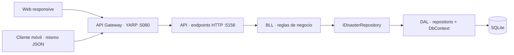

# Registro de desastres en .NET

Proyecto de taller en .NET 10: registra nombre, ubicación, severidad (1–5), descripción y coordenadas; consulta los reportes en un mapa. La presentación es una web responsive que funciona en computador y navegador móvil. Cualquier aplicación móvil nativa puede consumir la misma API JSON a través del gateway.

## Ejecutar

Requisito: SDK de .NET 10. No necesitas instalar un servidor de base de datos ni herramientas de frontend.

Desde la raíz de la solución:

```bash
dotnet restore
dotnet build
```

Terminal 1 — API:

```bash
dotnet run --project DisasterLocation --launch-profile http
```

Terminal 2 — gateway e interfaz:

```bash
dotnet run --project DisasterLocation.Gateway --launch-profile http
```

Abre **http://localhost:5080**. Escribe los datos, selecciona un punto en el mapa (o escribe latitud y longitud) y registra el desastre. Se agrega a la lista y al mapa. Los puntos usan colores según la severidad. El nombre de la ubicación es descriptivo: no se convierte automáticamente una dirección en coordenadas.

También puedes iniciar ambos procesos desde **Ejecutar y depurar → API + Gateway** en VS Code. Si ya tenías la plantilla ejecutándose en el puerto 5156, detén esa sesión y vuelve a iniciarla para cargar el nuevo código.

## Separación de arquitectura



| Proyecto | Responsabilidad | Archivo principal |
| --- | --- | --- |
| `DisasterLocation.Core` | Modelo, DTOs e interfaz del repositorio. Sin dependencias de infraestructura. | [IDisasterRepository.cs](DisasterLocation.Core/IDisasterRepository.cs), [Contracts.cs](DisasterLocation.Core/Contracts.cs) |
| `DisasterLocation.BLL` | Valida y normaliza los datos. Usa la abstracción del repositorio. | [DisasterService.cs](DisasterLocation.BLL/DisasterService.cs) |
| `DisasterLocation.DAL` | Configura SQLite, mapea la tabla, consulta y guarda usando EF Core. | [DisasterRepository.cs](DisasterLocation.DAL/DisasterRepository.cs), [DisasterDbContext.cs](DisasterLocation.DAL/DisasterDbContext.cs) |
| `DisasterLocation` | Recibe HTTP, llama a la BLL y devuelve códigos HTTP y JSON. Conecta las implementaciones mediante inyección de dependencias. | [Program.cs](DisasterLocation/Program.cs) |
| `DisasterLocation.Gateway` | Reenvía `/api/*` a la API con YARP y sirve los archivos de presentación. | [Program.cs](DisasterLocation.Gateway/Program.cs), [appsettings.json](DisasterLocation.Gateway/appsettings.json) |

La BLL y el DAL referencian Core. La API referencia BLL y DAL para registrar sus servicios. El gateway no tiene referencias a estos proyectos: no valida desastres ni accede a la base de datos.

### El DAL, paso a paso

1. La BLL valida el reporte y llama a `IDisasterRepository.AddAsync`.
2. La inyección de dependencias resuelve esa interfaz con `DisasterRepository`, implementado en el DAL.
3. El repositorio agrega la entidad al `DisasterDbContext` y llama a `SaveChangesAsync`.
4. EF Core ejecuta el `INSERT` en SQLite y devuelve el identificador generado.
5. La API responde `201 Created`; el gateway conserva el código, el JSON y la cabecera `Location`.

Para consultar se recorre el mismo camino con `GetAllAsync` o `GetByIdAsync`. El acceso a EF Core y SQLite está en el DAL. Puedes reemplazar el repositorio sin modificar los clientes ni las reglas de negocio.

La base se crea automáticamente en `DisasterLocation/App_Data/disasters.db`. Los registros sobreviven a reinicios. La conexión se configura en `DisasterLocation/appsettings.json`, sección `ConnectionStrings:Disasters`; una ruta relativa se resuelve desde el directorio de la API.

Para mantenerlo sencillo se usa `EnsureCreatedAsync`, sin migraciones. Si cambias el esquema durante el taller, elimina la base **solo si puedes perder sus datos**, o incorpora migraciones antes de conservar información existente. `EnsureCreatedAsync` no actualiza tablas ya creadas.

## Contrato compartido por web y móvil

| Método | Ruta del gateway | Resultado |
| --- | --- | --- |
| GET | `/api/desastres` | `200`, arreglo de desastres (vacío si no hay registros). |
| GET | `/api/desastres/{id}` | `200`, un desastre; `404` si no existe. |
| POST | `/api/desastres` | `201`, desastre creado con `id` y cabecera `Location`; `400` si los datos son inválidos. |

Solicitud de registro:

```json
{
  "nombre": "Inundación del río Bogotá",
  "ubicacion": "Bogotá, Cundinamarca",
  "severidad": 4,
  "descripcion": "Desbordamiento del río que afecta las vías del sector.",
  "latitud": 4.7110,
  "longitud": -74.0721
}
```

La respuesta tiene los mismos campos y un `id` entero generado por SQLite. Todos los campos de registro son obligatorios. Límites: nombre 120 caracteres, ubicación 200, descripción 2000; severidad entera de 1 a 5; latitud de −90 a 90; longitud de −180 a 180. Los errores de negocio incluyen un objeto `errors` con mensajes por campo en formato Problem Details.

Hay solicitudes listas para ejecutar en [DisasterLocation.http](DisasterLocation/DisasterLocation.http). El documento OpenAPI está en http://localhost:5156/openapi/v1.json cuando la API corre en desarrollo.

La presentación web llama a `fetch('/api/desastres')`. Un cliente móvil .NET puede enviar el mismo cuerpo:

```csharp
using System.Net.Http.Json;

using var client = new HttpClient { BaseAddress = new Uri("http://IP_DEL_COMPUTADOR:5080") };
var response = await client.PostAsJsonAsync("/api/desastres", new
{
    nombre = "Deslizamiento",
    ubicacion = "Bogotá",
    severidad = 3,
    descripcion = "Material sobre la vía.",
    latitud = 4.7110,
    longitud = -74.0721
});
response.EnsureSuccessStatusCode();
```

El gateway no necesita saber si la solicitud viene de una web o de una app móvil. Para ver la web en un celular conectado a la misma red, inicia el gateway con:

```bash
dotnet run --project DisasterLocation.Gateway --launch-profile http --urls http://0.0.0.0:5080
```

En el celular abre `http://IP_DEL_COMPUTADOR:5080`. `localhost` en el teléfono apunta al propio teléfono. La API puede seguir escuchando solo en localhost, ya que el gateway corre en el computador. La red y el firewall deben permitir el puerto 5080. Una app nativa puede requerir habilitar HTTP local en su configuración de desarrollo; para despliegue usa HTTPS.

Para una web alojada en otro origen, agrega su dirección exacta a `Cors:AllowedOrigins` en la configuración del gateway. La interfaz incluida usa el mismo origen y no necesita esta configuración. Si cambias el puerto de la API, actualiza `ReverseProxy:Clusters:disasters-api:Destinations:local:Address` en el gateway.

La biblioteca Leaflet está incluida localmente en `wwwroot/lib/leaflet` con su licencia. El mapa base de OpenStreetMap requiere internet. El formulario y la lista siguen disponibles si las imágenes del mapa no cargan.

## Verificación

```bash
dotnet build
python3 scripts/smoke_test.py
```

La prueba inicia API y gateway en puertos temporales y usa una base temporal. Verifica registro con clientes web y móvil, consulta, validación, reenvío de errores y cabeceras, CORS, restricciones del DAL y persistencia después de reiniciar la API. Al terminar detiene los procesos y elimina sus datos de prueba.

Referencias: [YARP](https://learn.microsoft.com/en-us/aspnet/core/fundamentals/servers/yarp/getting-started?view=aspnetcore-10.0), [EF Core con SQLite](https://learn.microsoft.com/en-us/training/modules/build-web-api-minimal-database/), [Leaflet 1.9](https://leafletjs.com/examples-v1/quick-start/).
