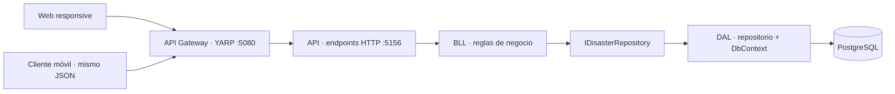

# Registro de desastres en .NET

Proyecto de taller en .NET 10: registra nombre, ubicación, severidad (1–5), descripción y coordenadas; consulta los reportes en un mapa. La presentación es una web responsive que funciona en computador y navegador móvil. Cualquier aplicación móvil nativa puede consumir la misma API JSON a través del gateway.

## Ejecutar

Requisitos: SDK de .NET 10, acceso a GitHub Packages para restaurar las bibliotecas privadas y una conexión PostgreSQL propia de esta API. La conexión se proporciona mediante `ConnectionStrings__Disasters`, fuera de los archivos versionados. Las conexiones TCP requieren `SSL Mode=VerifyFull` y una CA confiable.

Desde la raíz de la solución:

```bash
dotnet restore
dotnet build
```

Antes del primer arranque, aplica las migraciones con el comando administrativo descrito en la sección de persistencia.

Terminal 1 — API, con la ruta del archivo local protegido en `DISASTERS_CONNECTION_FILE`:

```bash
ConnectionStrings__Disasters="$(cat "$DISASTERS_CONNECTION_FILE")" \
  dotnet run --project DisasterLocation --no-launch-profile --urls http://localhost:5156
```

Terminal 2 — gateway e interfaz, desde esta misma raíz y con el repositorio independiente `disaster-api-gateway` situado junto a este repositorio:

```bash
ReverseProxy__Clusters__disasters-api__Destinations__local__Address=http://localhost:5156/ \
  dotnet run --project ../disaster-api-gateway/DisasterLocation.Gateway --launch-profile http
```

Abre **http://localhost:5080**. Escribe los datos, selecciona un punto en el mapa (o escribe latitud y longitud) y registra el desastre. Se agrega a la lista y al mapa. Los puntos usan colores según la severidad. El nombre de la ubicación es descriptivo: no se convierte automáticamente una dirección en coordenadas.

En las configuraciones de lanzamiento, proporciona la conexión únicamente al proceso API. El Gateway solo necesita la dirección HTTP del destino.

## Separación de arquitectura



| Proyecto | Responsabilidad | Archivo principal |
| --- | --- | --- |
| `DisasterLocation.Core` | DTOs HTTP propios; entidades e interfaces mediante `DisasterPlatform.Core`. | [Contracts.cs](DisasterLocation.Core/Contracts.cs) |
| `DisasterLocation.BLL` | Valida y normaliza los datos. Usa la abstracción del repositorio. | [DisasterService.cs](DisasterLocation.BLL/DisasterService.cs) |
| `DisasterPlatform.DAL` (NuGet) | Configura PostgreSQL, mapea la tabla, consulta y guarda usando EF Core. | [Repositorio compartido](https://github.com/disaster-management-platform/disaster-platform-dal) |
| `DisasterLocation` | Recibe HTTP, llama a la BLL y devuelve códigos HTTP y JSON. Conecta las implementaciones mediante inyección de dependencias. | [Program.cs](DisasterLocation/Program.cs) |
| `DisasterLocation.Gateway` (repositorio independiente) | Reenvía `/api/*` a la API con YARP y sirve los archivos de presentación. | [Program.cs](../disaster-api-gateway/DisasterLocation.Gateway/Program.cs), [appsettings.json](../disaster-api-gateway/DisasterLocation.Gateway/appsettings.json) |

La BLL y el DAL referencian Core. La API referencia BLL y DAL para registrar sus servicios. El gateway no tiene referencias a estos proyectos: no valida desastres ni accede a la base de datos.

### El DAL, paso a paso

1. La API lee `Idempotency-Key`. La BLL valida el UUID y el reporte, y consulta si esa operación ya existe.
2. La inyección de dependencias resuelve esa interfaz con `DisasterRepository`, implementado en el DAL.
3. Si la operación existe, la BLL compara los datos normalizados y devuelve el registro, o un conflicto si cambiaron.
4. Si no existe, el repositorio guarda con EF Core. Un índice único sobre `ClientRequestId` evita duplicados incluso si llegan dos solicitudes al mismo tiempo. Si otra solicitud guardó primero, se recupera su registro y la BLL también compara el contenido.
5. La API responde `201 Created` al crear, `200 OK` al recuperar o `409 Conflict` si se reutilizó la clave con otros datos. El gateway conserva estas respuestas.

Para consultar se recorre el mismo camino con `GetAllAsync` o `GetByIdAsync`. El acceso a EF Core y PostgreSQL está en el DAL. Puedes reemplazar el repositorio sin modificar los clientes ni las reglas de negocio.

La persistencia se distribuye mediante `DisasterPlatform.Core 2.0.0` y `DisasterPlatform.DAL 3.0.0`. Utiliza el esquema `disasters` de PostgreSQL y conserva `ClientRequestId`, el índice único, el ciclo de vida y la auditoría. La API conserva los campos originales y añade `radio` nullable, `phase` y `version` a las respuestas. `radio` es opcional en la creación y, cuando se informa, debe ser mayor que cero y no superar 1.000.000 metros.

Las migraciones se ejecutan explícitamente con una conexión administrativa separada. Con su archivo protegido indicado en `MIGRATION_CONNECTION_FILE`:

```bash
ConnectionStrings__Disasters="$(cat "$MIGRATION_CONNECTION_FILE")" \
  dotnet run --project DisasterLocation --no-launch-profile -- --Database:Migrate=true
```

Este comando aplica las cadenas PostgreSQL de ambos contextos del DAL y termina sin abrir el servidor HTTP. El arranque normal no aplica migraciones ni crea archivos locales. No se reutilizan historiales de SQLite.

Este servicio es el único escritor del esquema `disasters`. Reconstrucción lo consulta mediante HTTP. Las credenciales administrativas se reservan para migraciones y las APIs utilizan roles propios.

Para agregar otro cambio de esquema, desde el repositorio `disaster-platform-dal`:

```bash
dotnet tool restore
dotnet ef migrations add NombreDelCambio --project DisasterPlatform.DAL --context DisasterDbContext
```

La herramienta `dotnet-ef` está fijada a la misma versión que EF Core en `dotnet-tools.json`. La fábrica de diseño utiliza `ConnectionStrings__Disasters` y permite generar las migraciones sin iniciar la API. Los cambios se aplican con el comando explícito de migración y credenciales administrativas; la API utiliza sus propias credenciales de ejecución.

La seguridad común se consume mediante `DisasterPlatform.Security 1.0.0`. El registro y la consulta mantienen el acceso de los clientes anteriores; deben integrarse con identidad antes de exponer la plataforma públicamente. `PUT /api/desastres/{id}` y `/fase` requieren JWT con `sub`, `organization_id`, rol `reconstruction.write` y acceso mediante `disaster_id`. El historial requiere `reconstruction.read`. El catálogo permite lectura pública; su creación y desactivación requieren el rol `disasters.admin`. `Security__Authority` y `Security__Audience` configuran el proveedor existente; `Security__LocalDemo=true` solo se admite explícitamente en Development.

Las transiciones autorizadas son:

| Fase actual | Fases siguientes |
| --- | --- |
| Detected | Registered |
| Registered | Assessment, Response, Recovery, Closed |
| Assessment | Response, Recovery, Closed |
| Response | Recovery, Closed |
| Recovery | Reconstruction, Closed |
| Reconstruction | Closed |
| Closed | Ninguna |

`Registered=0`, `Response=1`, `Recovery=2` y `Closed=3` conservan sus valores; `Detected=4`, `Assessment=5` y `Reconstruction=6`. La creación conserva Registered. Cada cambio recibe `expectedVersion`; los saltos y cierres requieren `reason`. Cerrar requiere además `confirmNoCriticalCommitments=true`, confirmado por el responsable autorizado. La comprobación automática entre dominios está pendiente. La actualización, el incremento de versión y su auditoría se guardan en una transacción.

## Contrato compartido por web y móvil

| Método | Ruta del gateway | Resultado |
| --- | --- | --- |
| GET | `/api/desastres` | `200`, arreglo de desastres (vacío si no hay registros). |
| GET | `/api/desastres/{id}` | `200`, un desastre; `404` si no existe. |
| POST | `/api/desastres` | `201` al crear, `200` al repetir la operación, `409` si cambia su contenido; `400` si los datos o la clave son inválidos. |
| PUT | `/api/desastres/{id}` | Actualiza los campos autorizados con `expectedVersion`; `409` ante una versión obsoleta. |
| PUT | `/api/desastres/{id}/fase` | Cambia la fase con control de versión y auditoría. |
| GET | `/api/desastres/{id}/historial` | Historial autorizado con responsable, fecha, cambios, resultado y justificación. |
| GET / POST | `/api/tipos-desastre` | Consulta pública / alta administrativa. |
| PUT | `/api/tipos-desastre/{id}/desactivar` | Desactivación administrativa sin borrar referencias históricas. |

Solicitud de registro, con la cabecera `Idempotency-Key: 550e8400-e29b-41d4-a716-446655440000`:

```json
{
  "nombre": "Inundación del río Bogotá",
  "ubicacion": "Bogotá, Cundinamarca",
  "severidad": 4,
  "descripcion": "Desbordamiento del río que afecta las vías del sector.",
  "latitud": 4.7110,
  "longitud": -74.0721
}
```

La respuesta incluye los campos originales, un `id` entero generado por PostgreSQL, `radio` nullable, `phase` y `version`. Los seis atributos originales del ejemplo son obligatorios. `radio`, `disasterTypeId`, `startedAt` y `attentionLevel` son opcionales; su omisión representa información desconocida. El catálogo inicial incluye terremoto, inundación, incendio, deslizamiento, huracán y erupción volcánica. La clasificación de atención es independiente de severidad: 1 Bajo, 2 Medio, 3 Alto y 4 Crítico. `startedAt` acepta una fecha con zona horaria y se normaliza a UTC. `registeredAt` y `updatedAt` son generados por el servidor; los históricos sin fecha comprobable conservan null. Límites: nombre 120 caracteres, ubicación 200, descripción 2000; severidad entera de 1 a 5; latitud de −90 a 90; longitud de −180 a 180. Los errores de negocio incluyen un objeto `errors` con mensajes por campo en formato Problem Details.

Hay solicitudes listas para ejecutar en [DisasterLocation.http](DisasterLocation/DisasterLocation.http). El documento OpenAPI está en http://localhost:5156/openapi/v1.json cuando la API corre en desarrollo.

La presentación web llama a `fetch('/api/desastres')`. Un cliente móvil .NET puede enviar el mismo cuerpo:

```csharp
using System.Net.Http.Json;

using var client = new HttpClient { BaseAddress = new Uri("http://IP_DEL_COMPUTADOR:5080") };
// Generar una vez por reporte y conservar este valor para sus reintentos.
client.DefaultRequestHeaders.Add("Idempotency-Key", Guid.NewGuid().ToString());
var response = await client.PostAsJsonAsync("/api/desastres", new
{
    nombre = "Deslizamiento",
    ubicacion = "Bogotá",
    severidad = 3,
    descripcion = "Material sobre la vía.",
    latitud = 4.7110,
    longitud = -74.0721
});
response.EnsureSuccessStatusCode();
```

## Reintentos desde Android

Cada reporte pendiente debe tener su propio UUID, creado y guardado en el teléfono junto con el contenido antes del primer envío. Al recuperar la conexión, Android vuelve a enviar ese mismo cuerpo y esa misma clave. Tanto `201` como `200` confirman el registro: guarda el ID del servidor y marca el pendiente como sincronizado. Si se pierde la respuesta, se puede repetir la solicitud sin crear otro registro.

Un `400` requiere corregir los datos. Un `409` indica que la clave ya pertenece a otro contenido y requiere revisar el pendiente; no debe reintentarse indefinidamente ni cambiarse el UUID automáticamente. Para fallos de red o del servidor, conserva el pendiente y reintenta con espera progresiva. La cola local y el trabajo automático de sincronización se implementan en Android; este repositorio prepara la API. `DataSet` y `DataTable` son componentes de .NET y no se necesitan en el servidor para este flujo.

Con Retrofit, `@POST("desastres")` funciona si el `baseUrl` termina en `/api/`, por ejemplo `http://IP_DEL_COMPUTADOR:5080/api/`. El JSON de respuesta sigue teniendo los mismos campos, incluido el `id` entero, por lo que sirve para `DisasterInfoDto`.

La cabecera acepta un UUID con guiones, distinto de cero, sin distinguir mayúsculas. Si se envía vacía o con un formato inválido, se responde `400`. Para conservar la compatibilidad con la web actual, las solicitudes sin cabecera siguen creando registros, pero sus reenvíos no se deduplican. La comparación contempla los seis campos originales, `radio`, `disasterTypeId`, `startedAt` y `attentionLevel`, después de quitar los espacios al inicio y al final de los textos. Omitir `radio` equivale a enviarlo como `null`. Reutilizar la misma clave con un radio diferente, incluido cambiar entre `null` y un valor, devuelve `409` y no modifica el registro anterior.

El contenido original de creación se conserva de forma atómica e inmutable. Un POST repetido confirma ese contenido y su versión inicial, incluso si un PUT modificó después el desastre. GET devuelve el estado vigente; el cliente no debe reemplazarlo con un recibo histórico. Las operaciones anteriores conservan sus campos omitidos como null. Si el contenido histórico no puede reconstruirse con certeza, la repetición devuelve 409 y requiere revisión.

Puedes comprobarlo con:

```bash
KEY="550e8400-e29b-41d4-a716-446655440000"
BODY='{"nombre":"Deslizamiento","ubicacion":"Bogotá","severidad":4,"descripcion":"Deslizamiento sobre una vía","latitud":4.711,"longitud":-74.0721}'

curl -i http://localhost:5080/api/desastres \
  -H 'Content-Type: application/json' \
  -H "Idempotency-Key: $KEY" \
  -d "$BODY"
```

La primera vez devuelve `201`. Repite el comando: devuelve `200` con el mismo ID. Cambia `nombre` en `BODY` sin cambiar `KEY`: devuelve `409`. Con `curl http://localhost:5080/api/desastres` puedes confirmar que solo se creó un registro para esa operación.

El gateway no necesita saber si la solicitud viene de una web o de una app móvil. Para ver la web en un celular conectado a la misma red, inicia el gateway con:

```bash
ReverseProxy__Clusters__disasters-api__Destinations__local__Address=http://localhost:5156/ \
  dotnet run --project ../disaster-api-gateway/DisasterLocation.Gateway --launch-profile http --urls http://0.0.0.0:5080
```

En el celular abre `http://IP_DEL_COMPUTADOR:5080`. `localhost` en el teléfono apunta al propio teléfono. La API puede seguir escuchando solo en localhost, ya que el gateway corre en el computador. La red y el firewall deben permitir el puerto 5080. Una app nativa puede requerir habilitar HTTP local en su configuración de desarrollo; para despliegue usa HTTPS.

Para una web alojada en otro origen, agrega su dirección exacta a `Cors:AllowedOrigins` en la configuración del gateway. La interfaz incluida usa el mismo origen y no necesita esta configuración. Si cambias el puerto de la API, actualiza `ReverseProxy:Clusters:disasters-api:Destinations:local:Address` en el gateway.

La biblioteca Leaflet está incluida localmente en `wwwroot/lib/leaflet` del repositorio `disaster-api-gateway`, con su licencia. El mapa base de OpenStreetMap requiere internet. El formulario y la lista siguen disponibles si las imágenes del mapa no cargan.

## Verificación

Las pruebas requieren `psycopg2` y un PostgreSQL local accesible por socket Unix, cuyo usuario pueda crear bases temporales. Configura `PGSOCKET` con el directorio de ese socket:

```bash
export TEST_POSTGRES_DSN="host=${PGSOCKET:?Configura el socket PostgreSQL local} port=5432 dbname=postgres user=$(id -un)"
export TEST_POSTGRES_CONNECTION="Host=$PGSOCKET;Port=5432;Database=postgres;Username=$(id -un)"
dotnet build
dotnet test --no-build
dotnet build ../disaster-api-gateway/DisasterLocation.Gateway.sln
python3 scripts/smoke_test.py
```

La prueba inicia API y gateway en puertos temporales y usa bases temporales. Comprueba el registro web y móvil, validación, reintentos `201/200`, conflictos `409`, solicitudes concurrentes, CORS y el índice único. También comprueba que un reintento conserva su ID tras reiniciar la API y que dos instancias comparten la misma operación idempotente. Las migraciones se aplican antes de iniciar las APIs de prueba. Al terminar detiene los procesos y elimina sus datos de prueba.

Referencias: [YARP](https://learn.microsoft.com/en-us/aspnet/core/fundamentals/servers/yarp/getting-started?view=aspnetcore-10.0), [Npgsql con EF Core](https://www.npgsql.org/efcore/), [Leaflet 1.9](https://leafletjs.com/examples-v1/quick-start/).
